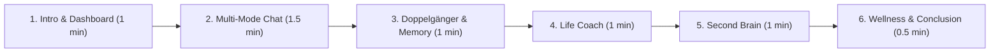

# College Demonstration Guide: Chatbox — A Complete Companion

**Presentation Duration:** 5–7 Minutes  
**Target Audience:** Academic Evaluators, Capstone Committee, Peer Reviewers  
**Application Binary:** `dist/Chatbox/Chatbox.exe` or `target/chatbox-companion-1.0.0.jar`

---

## 1. Demonstration Setup & Pre-Flight Checklist

Before the committee sits down:
1. **Launch the Application**:
   - Double click `dist\Chatbox\Chatbox.exe` (or run `java -jar target/chatbox-companion-1.0.0.jar`).
   - The application window opens smoothly in 1240x800 resolution with the charcoal dark theme.
2. **Verify Database State**:
   - The dashboard displays seeded baseline cards: active goals, habits, mood score, and documents.
3. **Connectivity Readiness**:
   - If Wi-Fi is available, have a Gemini API key ready in the clipboard.
   - If offline or on restricted college guest Wi-Fi, proceed with confidence in **Offline Demonstration Mode** (see Section 6).

---

## 2. Recommended Presentation Order & 6-Minute Script

### Minute 0:00 – 1:00 | Architecture & Dashboard
- **Speaker**: *"Good morning, members of the evaluation committee. I present **Chatbox — A Complete Companion**, an offline-first, native Java 21 desktop companion application built with JavaFX and SQLite. Unlike typical web-wrapped Electron apps, Chatbox runs directly on the JVM with near-instant cold start, low RAM consumption, and complete local data sovereignty."*
- **Action**: Point to the **Dashboard**:
  - Show the live stat cards: Active Goals, Today's Habits, 7-Day Mood Average, and Knowledge Documents.
  - Highlight the AI Status badge in the top right.

### Minute 1:00 – 2:30 | Multi-Mode AI Chatbox
- **Speaker**: *"Chatbox features five dedicated conversation modes, each governed by specialized behavioral guidelines and system instructions."*
- **Action**:
  - Click **AI Chatbox** in the sidebar.
  - Select mode **`GENERAL`** from the dropdown.
  - Enter sample prompt:
    > `"What are the key trade-offs between local-first software and cloud-only software?"`
  - Show the response rendering.
  - If showing **Offline Demo Mode**, type slash command:
    > `"/plan"`
  - Point out the structured 3-phase study and focus schedule generated by the offline rule engine.

### Minute 2:30 – 3:30 | Digital Doppelgänger & Memory Governance
- **Speaker**: *"Next is our Digital Doppelgänger persona engine and privacy-first Memory Governance system. The companion personalizes interactions using declared identity traits, but enforces strict consent."*
- **Action**:
  - Click **Digital Doppelgänger**: Show the user's name ("Ayush"), interests, communication style, and goals.
  - Click **Memory Manager**:
    - Point out the list of user memories categorized by `FACT`, `PREFERENCE`, and `GOAL`.
    - Show the **Approval** status badge.
    - Click **Toggle Approval** on a candidate memory to demonstrate the consent gating: *only approved memories enter AI prompts*.

### Minute 3:30 – 4:30 | AI Life Coach & Habit Tracking
- **Speaker**: *"In the Life Coach module, we provide milestone decomposition. When students complete subtasks, the parent goal's progress bar automatically recalculates."*
- **Action**:
  - Click **Life Coach** -> **Goals** tab.
  - Point to existing goal (e.g., *"Master Distributed Systems"*).
  - Switch to **Tasks** tab. Mark a task as complete.
  - Return to **Goals** tab: Show the progress bar updated in real-time.
  - Switch to **Habits** tab. Toggle a habit checkbox (e.g., *"Deep Work Focus Sprint"*) to show daily streak tracking.

### Minute 4:30 – 5:30 | Personal Second Brain (Document Intelligence)
- **Speaker**: *"Students often struggle to find grounded evidence in lecture notes. The Second Brain module ingests PDF, Markdown, and text documents using Apache PDFBox 3.x, searching passages without sending files to the cloud."*
- **Action**:
  - Click **Second Brain**.
  - Click **Import Document**.
  - Navigate to `sample-documents/capstone-brief.pdf` (or `ai-desktop-systems.md`) and select it.
  - Point out the table updating with the document title, file type, and word count.
  - In the search bar, type:
    > `"WAL mode"`
  - Click **Search**: Show the extracted snippet and document citation.
  - Switch back to **AI Chatbox**, set mode to **`KNOWLEDGE`**, and prompt:
    > `"What architecture does Chatbox use?"`
  - Show the grounded answer explicitly citing the source document.

### Minute 5:30 – 6:00 | Mental Wellness & Privacy Review
- **Speaker**: *"Finally, the Mental Wellness module provides a 5-point mood tracker, private reflection journal, and a guided 4-7-8 breathing exercise."*
- **Action**:
  - Click **Mental Wellness**.
  - Click **Start Breathing Exercise**: Show the smooth JavaFX breathing pulse circle.
  - **Emphasize Privacy**: *"Crucially, our privacy architecture guarantees that private journal entries are completely isolated. They never enter AI prompt contexts, ensuring student vulnerability is protected."*

---

## 3. Sample Non-Sensitive Prompts for the Demo

Use these pre-tested, academically sound prompts:

| Mode | Input / Prompt | Purpose / Demonstrated Feature |
|:---|:---|:---|
| **GENERAL** | `"What are the key trade-offs between local-first software and cloud-only software?"` | Structured reasoning & response formatting |
| **COACH** | `"I have 3 assignments due next week. How should I prioritize them?"` | Actionable task breakdown & tone adaptation |
| **KNOWLEDGE** | `"What architecture decisions were made for Chatbox?"` | Grounded retrieval citing `ai-desktop-systems.md` |
| **OFFLINE** | `"/plan"` or `"/study"` | Deterministic 3-phase study focus schedule |
| **OFFLINE** | `"/goals"` | Actionable goal completion framework |
| **OFFLINE** | `"/wellness"` | Immediate grounding and breathing instructions |

---

## 4. Example Document-Import Workflow

1. Open **Second Brain** from the sidebar.
2. Click **Import Document**.
3. Choose one of the verified sample files located in the repository:
   - `sample-documents/capstone-brief.pdf` *(Clean digital PDF)*
   - `sample-documents/ai-desktop-systems.md` *(Markdown architecture notes)*
   - `sample-documents/software-engineering-goals.txt` *(Plaintext notes)*
4. The table displays:
   - `capstone-brief` | `PDF` | `37 words` | `C:/.../capstone-brief.pdf`
5. In the search box, enter `"Architecture"` and click **Search**.
6. View the highlighted excerpt:
   > *"Architecture: Native Java 21 LTS + JavaFX 21 + SQLite with WAL mode."*

---

## 5. Demonstrating Offline Functionality (No Internet Needed)

If the committee asks *"Does this work without an internet connection?"*:
1. Navigate to **Settings**.
2. Check the box: **Force Offline Mode**.
3. Click **Save Settings**.
4. The status indicator immediately displays `○ Offline Demo`.
5. Switch to **AI Chatbox** and send: `"How do I manage stress before my exams?"`
6. The companion responds instantly with the deterministic offline guidance banner and actionable recommendations.
7. Send: `"/help"` to display all supported offline slash commands.

---

## 6. Expected Outcomes & Fallback Steps

| Scenario | Expected Outcome | Fallback Step |
|:---|:---|:---|
| **Wi-Fi is down or blocked** | Offline Demo Mode responds instantly | Keep "Force Offline Mode" enabled in Settings. Explain that offline-first reliability was an intentional design requirement. |
| **Gemini API returns 429 (Rate Limit)** | UI shows structured warning dialog | Explain that API rate limiting was anticipated, and switch to Offline Demo mode to continue seamlessly. |
| **Database appears empty** | Seed data automatically loads on launch | In Settings, click "Seed Sample Data" or restart the application to reset default sample goals and habits. |
| **Committee asks to inspect database file** | SQLite file is readily viewable | Open `%USERPROFILE%\.chatbox\chatbox.db` in any SQLite viewer (e.g. DB Browser for SQLite) to prove real relational tables and WAL mode. |
